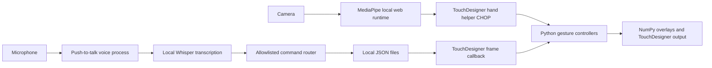

# JARVIS Interface

I built JARVIS to explore a visual interface controlled by hand gestures and short voice commands. TouchDesigner renders the camera feed and animated HUD, while Python handles pinch interaction, floating panels, a country globe, and a separate local voice service.

This repository contains the Python source extracted from my saved prototype and the local reliability improvements. The original TouchDesigner scene and its assets are kept separately while I review their redistribution rights. It is a portfolio prototype, with live hardware checks still in progress.

## How it works

The scene uses [torinmb’s MediaPipe TouchDesigner plugin](https://github.com/torinmb/mediapipe-touchdesigner) for computer vision. Its local web runtime passes tracking results into TouchDesigner. My HUD callbacks read the hand helper CHOP and route pinch input to the globe, workspaces, central hologram, or portrait panels. NumPy draws the overlays into a 960×540 Script TOP, which TouchDesigner composites over the camera or a cinematic background.

The voice service runs in a separate Python process. It records a bounded microphone clip, transcribes it with faster-whisper on the CPU, and matches one complete command from an allowlist. Atomic JSON files carry commands and status to a TouchDesigner Execute DAT. The bridge polls at most ten times per second, calls the existing controllers, and writes an acknowledgement. It runs no transcription or blocking audio work on the rendering thread.



The country-linked panels are a saved visual demonstration. They do not identify people or determine anyone’s real location. The wireframe face is a procedural graphic. Labels such as “system diagnostics” refer to prototype UI panels, not a complete system-monitoring application.

## Run it locally

The existing prototype was opened in TouchDesigner **2025.33230 on macOS**. The voice environment uses **Python 3.12.2**. The full interface requires an activated TouchDesigner installation, a privacy-reviewed local `release` folder, and owner-approved camera and microphone use. This source checkout alone does not contain a runnable visual scene.

Prepare a new copy of the scene and update its installed Python DATs:

```sh
python3 tools/prepare_local_scene.py /path/to/release "$PWD/local-scene/development" \
  --review-manifest /path/to/review-manifest.json
```

The preparation script requires a completed privacy review manifest with approved file hashes. It refuses unreviewed or changed input and iCloud placeholders. No personal recordings or portraits belong in the source folder. Open `local-scene/development/Hand_Tracking_Jarvis_V1.toe` in TouchDesigner. Keep that folder intact. The preparation script copies the existing assets, updates saved paths, installs the maintained bridge and gesture callback, and preserves the original scene alongside the updated one. It refuses to overwrite an existing output folder. Open `/project1/gesture_hud/FINAL_OUTPUT` to view the interface, and keep the timeline running.

Set up the voice environment in the **copied scene’s voice folder** so both processes use the same JSON files:

```sh
cd local-scene/development/JARVIS_VOICE_V20
python3 -m venv .venv
source .venv/bin/activate
python -m pip install -r requirements.txt
python voice_service.py --activation panel --enable-microphone
```

Microphone capture is disabled by default. The owner must explicitly opt in with `--enable-microphone`; neither tests nor typed commands need it. The small control window has a **Speak** button. Click it, say a command, then click **Stop recording** or let the five-second limit finish. Recording, transcription, and speech playback run on a worker thread. The model loads once per process. This removes terminal focus from everyday use without adding a global keyboard hook or continuously recording the room.

The launcher `START_JARVIS_VOICE.command` forwards these options and can create its environment on first use. It does not enable microphone capture automatically. For the original terminal workflow, run `python voice_service.py --activation enter --enable-microphone`. Tkinter is required for the panel; use the terminal mode if your Python distribution does not include it.

```sh
python voice_service.py --list-devices
python voice_service.py --text "Jarvis, show Japan" --no-speak
python voice_service.py --activation panel --local-model-only --enable-microphone
```

The text command tests routing and scene communication without recording audio. A missing scene acknowledgement is reported explicitly. `--local-model-only` refuses to download a missing model. Microphone permissions must be granted to the application hosting Python. Set `input_device` in `settings.json` to a device index if the default input is wrong.

## Controls

| Input | Action |
| --- | --- |
| Pinch over a globe, workspace, or hologram control | Begin that control’s interaction |
| Hold a captured pinch and move | Drag or manipulate the captured element |
| Release the pinch or lose tracking | Release the capture |
| “Jarvis, show Japan” | Select a saved country |
| “Jarvis, open globe” | Open the globe |
| “Jarvis, open tracking” | Open the tracking workspace |
| “Jarvis, switch to cinematic mode” | Replace the camera background |
| “Jarvis, reset core” | Reset the central hologram |
| “Jarvis, mute ambient sound” | Mute the optional ambient loop |
| “Jarvis, help” | Read the supported command categories |

Voice commands start with “Jarvis” and contain one complete action. Negated, compound, and ambiguous phrases are rejected. “Jarvis” is checked after transcription; it is not an always-listening wake-word detector. The legacy “analyze Joey locations” command cycles three saved country links and retains its original compatibility name.

## Privacy and dependencies

Microphone clips stay in memory and are discarded after recognition. The service never writes audio files, raw transcripts, free-form replies, or exception messages to its JSON state. Only canonical allowlisted actions, sequence numbers, timestamps, phase flags, and fixed diagnostic codes cross the file bridge. Unmatched speech is neither logged nor forwarded to a language model, even when an old settings file enables Ollama.

Camera processing uses the existing MediaPipe local runtime. The maintained HUD code draws arrays in memory and does not export frames during normal operation. The privacy cleanup removed personal portraits, recording-derived ambience, stored speech text, and saved tracking caches from the reviewed local scenes. Generic geometric panels and silence preserve the expected asset paths. Saving a third-party editor session can serialize operator state, so a reviewed scene file is still required for any export.

First-time dependency installation contacts the Python package index. Loading an uncached Whisper model downloads weights from Hugging Face; `--local-model-only` prevents that download. Those setup requests do not contain speech or camera data. The Python runtime has no hosted recognition API or free-form text-forwarding path. MediaPipe serves bundled resources locally and uses a loopback connection to TouchDesigner. Its third-party browser runtime has not undergone a complete network or forensic audit.

No live microphone or camera testing was performed during the privacy cleanup. The tests use typed commands, synthetic buffers, and mocked device boundaries. Original scene and asset packages remain excluded from this source-only publication candidate.
See [architecture](docs/ARCHITECTURE.md), [validation](docs/VALIDATION.md), [privacy](docs/PRIVACY.md), and [source provenance](PROVENANCE.md). Upstream components and the remaining textures and graphics still need a redistribution review. No license is asserted for them.

## Tests

```sh
python -m pip install -r JARVIS_VOICE_V20/requirements.txt
python -m unittest discover -s tests -v
```

The tests cover routing, real temporary-file exchange at the bridge boundary, acknowledgements, stale packets, malformed JSON, process locking, gesture inputs, pinch jitter, and tracking loss. They do not substitute for speaking into a microphone or demonstrating gestures in front of a camera. See the validation record for the exact checks completed and the remaining limitations.
