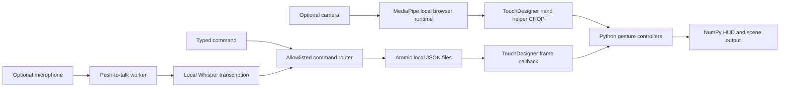

# JARVIS Interface

I built JARVIS to explore an interface controlled by hand gestures and short voice commands. TouchDesigner renders the animated HUD, while Python handles pinch interaction, floating workspaces, a projected globe and a separate local voice service.

**This is a source-only portfolio release.** It includes the Python modules, tests and integration notes. It does not include a runnable `.toe` scene, MediaPipe components or visual assets. I kept those out because I could not establish redistribution rights for every component and asset in the saved prototype. You can run the command code and tests without a camera, microphone, Whisper model or TouchDesigner installation.

## Try the code without devices

Use Python 3.12. The local validation environment was Python 3.12.2 on macOS. From the repository folder:

```sh
python3.12 -m venv .venv
source .venv/bin/activate
python -m pip install 'numpy>=1.26,<3'
python -m unittest discover -s tests -v
python JARVIS_VOICE_V20/voice_service.py --text "Jarvis help" --no-speak
```

The tests use synthetic audio, hand coordinates and temporary files. They replace the device and TouchDesigner boundaries rather than opening hardware. The help command uses only Python's standard library. To exercise an action packet:

```sh
python JARVIS_VOICE_V20/voice_service.py --text "Jarvis show Japan" --no-speak
```

Without a compatible running scene, the service reports that the action is queued and unconfirmed. This checks parsing and file transport, not an on-screen action. The test suite also exercises the actual service and bridge together using temporary JSON files and a synthetic scene boundary, including the matching acknowledgement. Runtime JSON contains canonical actions and diagnostics, not the typed sentence or a speech transcript.

## How the interface works

The private prototype uses [torinmb's MediaPipe TouchDesigner plugin](https://github.com/torinmb/mediapipe-touchdesigner). Its local browser runtime sends tracking results into TouchDesigner. The HUD callbacks read the hand helper CHOP and route a pinch to the globe, workspace, central hologram or saved panels. NumPy composites the overlays into a 960×540 Script TOP.



Speech recognition runs in a separate Python process so it does not block rendering. The bridge polls on available frames, at most ten times per second, dispatches one allowlisted action and writes an acknowledgement. Stale packets expire, and stale voice status releases audio ducking after a process failure. Separate pinch acquisition and release thresholds reduce jitter; invalid or lost tracking releases capture.

I replaced the terminal-only activation workflow with a small push-to-talk window. Capture and recognition run on one worker, clips are bounded, and Enter mode remains available. I kept a deliberate trigger instead of adding continuous wake detection without hardware evidence. “Jarvis” is checked after transcription; it is not an always-listening detector.

## Commands and visual controls

| Input | Intended scene action |
| --- | --- |
| Pinch and hold a control, then move | Capture and manipulate that control |
| Release the pinch or lose tracking | Release capture |
| “Jarvis show Japan” | Select a saved country link |
| “Jarvis open globe” | Open the projected globe |
| “Jarvis open tracking” | Open the tracking workspace |
| “Jarvis switch to cinematic mode” | Select the non-camera background |
| “Jarvis reset core” | Reset the central hologram |
| “Jarvis mute ambient sound” | Mute the optional ambience |

The router requires a complete command and rejects negated, compound and ambiguous phrases. Country links are a visual demonstration, not identity recognition or real location tracking. The wireframe face is procedural. The “system” workspace is a prototype panel rather than a complete monitoring tool.

## Full scene and optional hardware

The private prototype previously opened in TouchDesigner **2025.33230 on macOS**. That is the checked build, not a claimed minimum or a guarantee for other releases. This checkout cannot recreate its node network from the extracted Python alone. Installing the latest upstream MediaPipe demo does not recreate JARVIS either.

[Local scene setup](docs/LOCAL_SCENE.md) explains the required private scene, assets, MediaPipe dependency and adjacent voice folder. Voice capture additionally needs the packages in `JARVIS_VOICE_V20/requirements.txt`, Tkinter for the panel and explicit `--enable-microphone` opt-in. Uncached Whisper weights are downloaded unless `--local-model-only` is used. These are optional hardware steps, not prerequisites for the device-free quick start.

No camera or microphone was activated during final preparation. Live recognition accuracy, the real push-to-talk window, full physical gesture workflows and sustained performance remain unverified. Cinematic mode hides the camera layer; it does not disable the independent MediaPipe capture path. I omitted screenshots because a newly launched private scene could activate that path, and the older camera-free image still contains graphics whose redistribution basis is incomplete.

## Privacy and provenance

Microphone audio stays in memory. The maintained service writes no audio files or raw transcripts and does not forward unknown speech to a language model. Its JSON bridge carries only fixed actions, timestamps, sequence numbers, flags and diagnostic codes. Camera frames are processed in memory by the existing scene runtime; a later saved editor session can serialize operator state and needs another review before export.

The candidate contains no binary scene, photographs, audio, model weights or third-party asset package. No source-code license has been assigned. See [distribution and attribution](docs/DISTRIBUTION.md), [source provenance](PROVENANCE.md), [privacy](docs/PRIVACY.md), [architecture](docs/ARCHITECTURE.md) and [validation](docs/VALIDATION.md) for the boundaries and evidence.
